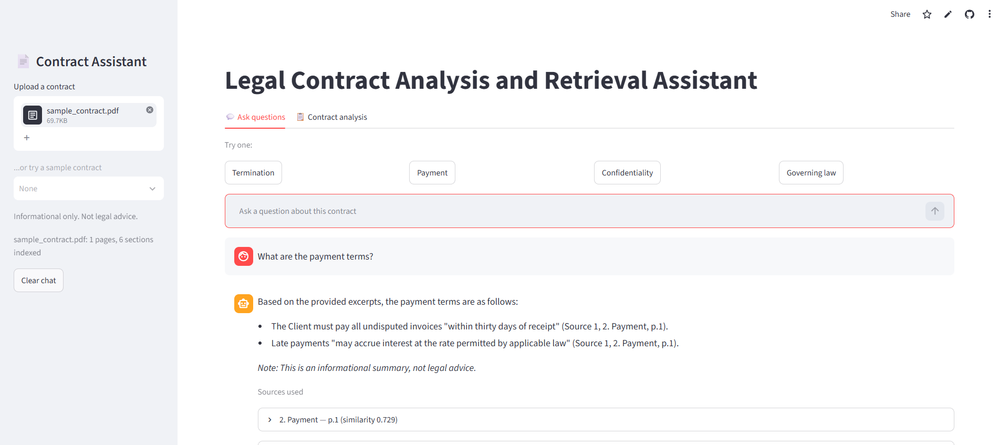
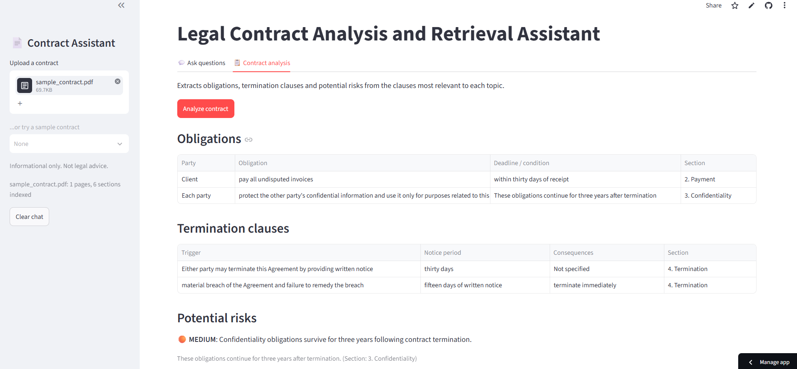
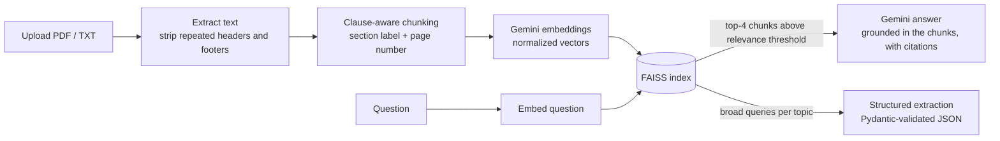

# Legal Contract Analysis and Retrieval Assistant

A RAG application that answers questions about an uploaded legal contract, grounding every answer in the specific clauses it came from, and extracts structured details (obligations, termination clauses, potential risks) for compliance-style review.

**Live demo:** <!-- TODO: paste your Streamlit link here -->

<!-- TODO: add 2 screenshots here: the chat with "Sources used" expanded, and the Contract analysis tab


-->

> Informational tool only. It is not legal advice.

## Features

- **Ask questions in plain English.** Each answer cites the contract section and page it used, and the source clauses can be expanded to check the text.
- **Says "not found" instead of guessing** when the contract does not cover a question.
- **Contract analysis.** Extracts obligations, termination clauses and potential risks (with a severity level) as validated JSON, shown as tables and downloadable.
- Accepts PDF and plain-text contracts.

## How it works



**Stack:** Python, Streamlit, Google Gemini API (generation and embeddings), FAISS, pypdf, Pydantic.

## Design decisions

- **Clause-aware chunking instead of fixed-size splitting.** Contracts have structure, so the chunker detects numbered headings (`12.3 Entire Agreement.`), lettered sub-clauses (`(a) Equitable Remedies.`) and appendices, and keeps each clause together. Long clauses are split on sentence boundaries with a short overlap. Every chunk carries a label such as `Appendix B > 7. Miscellaneous. > (g) Governing Law.` and its real page number, which is what makes precise citations possible.
- **Cosine similarity via normalized vectors and `IndexFlatIP`.** For unit vectors the inner product equals cosine similarity. A flat (exact) index is right at this scale, since one contract is tens to hundreds of chunks. For thousands of contracts I would move to an approximate index (IVF or HNSW).
- **Separate embedding task types** for documents and queries, as the Gemini embedding model is trained to expect.
- **Two layers against hallucination.** A relevance threshold stops clearly off-topic questions before the LLM is called, and the prompt tells the model to answer only from the provided excerpts and otherwise reply "I couldn't find this in the uploaded contract." When the model refuses, the app hides the retrieved clauses so they are not mistaken for sources.
- **Structured extraction with a schema.** Gemini returns JSON for a Pydantic model, which is validated before use. The prompt forbids claiming a clause is missing, because the model only sees retrieved excerpts, not the whole contract.
- **Reliability.** API calls use a timeout, exponential backoff, and a fallback model. Embeddings are rate-limited client-side, checkpointed after every batch, and cached on disk so a contract is embedded only once.

## Evaluation

I wrote 28 questions over two real, publicly filed contracts (an employment offer letter with restrictive-covenant appendices, and a software license agreement): 21 that the contract answers and 7 that it does not. Expected answers were checked against the contract text. Retrieval is scored by whether the clause containing the answer is among the retrieved chunks, and answers by whether they contain the key fact.

Reproduce with `python eval/run_eval.py` (add `--retrieval-only` for a fast, almost quota-free run). Results are saved to `eval/results.md`.

| Metric | Result |
|---|---|
| Right clause is the top-1 chunk | 17/21 (81%) |
| Right clause is in the top-4 chunks | 21/21 (100%) |
| Right clause survives the relevance threshold | <!-- TODO: update after the final run, 20/21 at threshold 0.62 --> |
| Answerable questions answered correctly | <!-- TODO: from the full run --> |
| Uncovered questions correctly refused | <!-- TODO: from the full run --> |

**What the evaluation showed**

- Top-4 retrieval found the right clause for every answerable question, which is why the app passes four chunks to the model. Generic phrasing sometimes ranks the right clause second to fourth.
- One answerable question scored just below the original 0.62 threshold and would have been wrongly refused, so I lowered the threshold to 0.60 (the off-topic questions I tried all scored 0.58 or lower).
- **The threshold cannot separate "covered" from "not covered" questions.** Contract-sounding questions the contract does not cover (arbitration, insurance, escrow) scored 0.64 to 0.69, the same range as real answers. The threshold only filters clearly off-topic questions. For the rest, the grounding prompt is the safeguard, which is what the answer-level results above measure.

## Limitations

- **Heading detection is heuristic** (regular expressions). It handles the numbered, lettered and inline-heading styles I tested, but unusual formats can be missed, and one section of the offer letter was not detected. A missed heading means a chunk is labeled with the previous section.
- **Chunking depends on how the PDF library splits lines**, so versions are pinned in `requirements.txt`. Scanned PDFs (images) are not supported because there is no OCR.
- **Free-tier API quotas.** About 90 embedding requests per minute and 1,000 texts per day, so indexing a very long contract (hundreds of chunks) takes minutes the first time.
- **Risk analysis is a model's first-pass opinion** based on retrieved clauses, not a legal assessment.
- The evaluation is small (two contracts, 28 questions), and the answer check matches key facts as text, so it can mark a correct paraphrase as wrong.

## Run it locally

```bash
git clone <your-repo-url>
cd <your-repo>
python -m venv venv
venv\Scripts\activate          # macOS/Linux: source venv/bin/activate
pip install -r requirements.txt
```

Create a `.env` file with your key from Google AI Studio:

```
GEMINI_API_KEY=your_key_here
```

```bash
streamlit run app.py
```

## Project structure

```
app.py              Streamlit app (upload, chat with citations, contract analysis)
src/
  loader.py         PDF/TXT loading, removal of repeated headers and footers
  chunker.py        clause-aware chunking, labels, page tracking
  embedder.py       Gemini embeddings: batching, rate limiting, disk cache
  vector_store.py   FAISS index
  retriever.py      chunk, embed, index, search with a relevance threshold
  generator.py      grounded answers, retry and fallback model
  extractor.py      structured extraction (obligations, termination, risks)
  config.py         models and settings
eval/               question set, evaluation script and results
data/               public contracts used for testing
```
